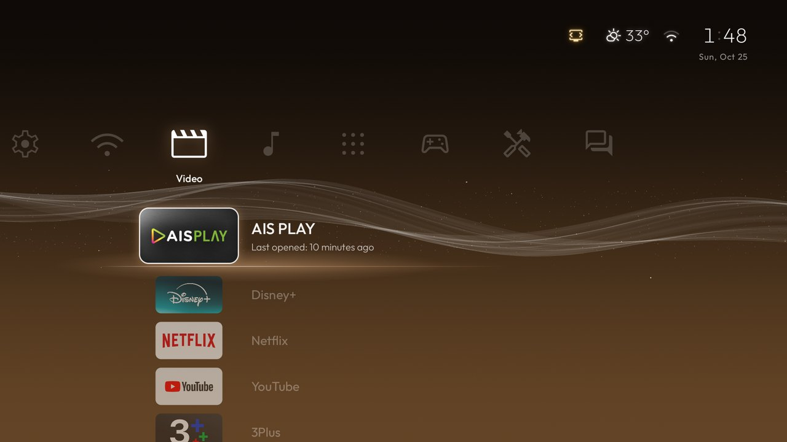
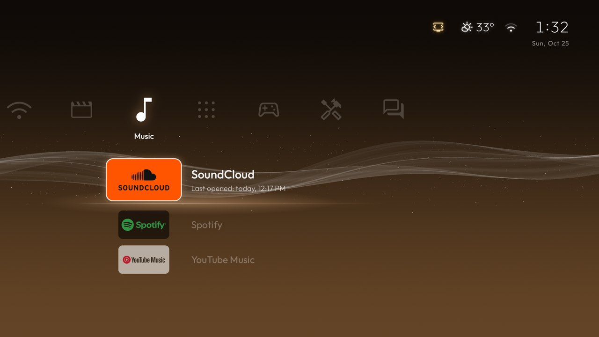
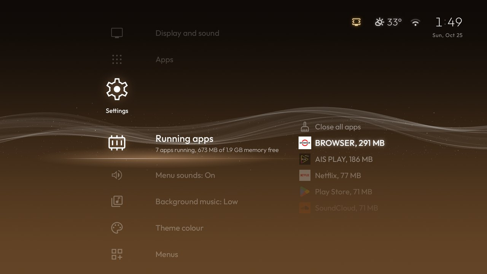
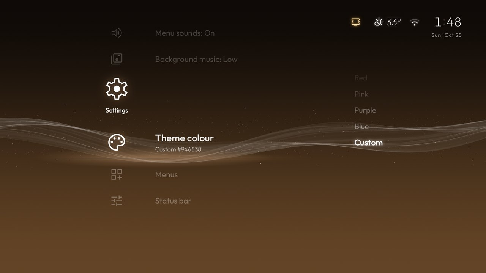
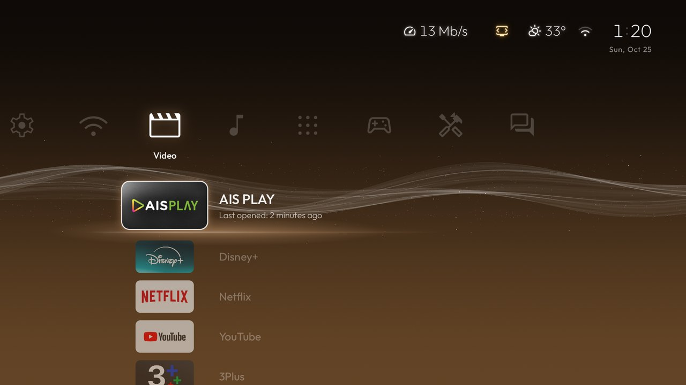

<p align="center"></p>

# Crossbar

**An XMB-style home screen for Android TV and Google TV.** The categories run across the screen, the apps and
settings of the one you are on run down from it, and a wave like the PlayStation 3's drifts behind, in a colour
for each month.

Crossbar is a fork of [CleanYourTV](https://github.com/Gathin23/cleanyourtv). Its tile launcher is replaced by
the cross-bar; the debloat tools, the TV lists and the rest are CleanYourTV's, merged in from time to time.

Tested on a Xiaomi Mi Box S 2nd gen (Google TV 11). It should run on any Android TV or Google TV with Android 8.0
or newer, but no other device has been tried yet.

## Screenshots

| | |
|---|---|
|  |  |
| **Music.** Each category keeps the app you were last on. | **Running apps.** Every app left running and its memory; OK closes it. |
|  |  |
| **Theme colour.** A colour for each month, a fixed one, or your own. | **Status row.** The download speed comes in at the far left while the box downloads. |

## What it does

| | |
|---|---|
| **Cross-bar** | Settings, Network, Video, Music and Apps, plus categories of your own: Games, Tools, Social, Sports, News, Kids, Learning, Shopping, Photos or any name. Apps sort themselves into them; hold OK on an app to move or reorder it. |
| **The wave** | Drawn with OpenGL ES, in a colour for each month or one you pick, dimmer at night. A start-up animation is drawn with it when the box starts or wakes, and after 45 seconds without a key the menu fades and only the wave stays. |
| **Status row** | The clock, the connection, the weather and fine dust (PM2.5). Only while there is something to say: the download speed, an app installing, a USB drive, Bluetooth audio, a low remote battery, low storage, ADB left on. |
| **Running apps** | The apps left running behind Home and the memory each holds; close one, or all of them. |
| **Network** | The connection and its address, the Private DNS in use, and an Internet speed test when you ask for one. |
| **Sound** | Menu sounds and a quiet background loop, from files you put on the TV. None are included. |
| **Language** | English and Thai, following the TV's language. |
| **Motion** | Nothing jumps: every change slides or fades, and the menu draws at 60 frames a second on the Mi Box S. |

The details, every setting and what each part costs: [docs/xmb.md](../docs/xmb.md).

## Install

You need a computer on the same network as the TV, with Python 3, JDK 17 and the Android SDK (platform 34,
build-tools 34.0.0). On macOS: `brew install openjdk@17 android-commandlinetools`, then
`sdkmanager "platforms;android-34" "build-tools;34.0.0"`.

1. **On the TV:** Settings > System (Device Preferences on Android TV) > About, and press OK on the build number
   seven times. Then, in Developer options, turn on **USB debugging**, and **Network debugging** if it is listed.
2. **On the computer:**

   ```bash
   git clone https://github.com/mctery/cleanyourtv.git && cd cleanyourtv
   python3 -m venv tools/venv && tools/venv/bin/pip install -r tools/requirements.txt
   export TV_HOST=192.168.1.50                  # the TV's IP address
   INPUT_KEY_SERVICE=1 RESTORE_KEY_SERVICES=1 launcher/build-and-install.sh
   ```

   Accept "Allow USB debugging?" on the TV. The script builds Crossbar, installs it, makes it the Home app and
   switches off the stock home screen; if Home does not land on Crossbar, it puts the stock one back.
   `INPUT_KEY_SERVICE=1` turns on Crossbar's remote-button helper, which keeps the Input button working and
   closes apps for Running apps; `RESTORE_KEY_SERVICES=1` lets Crossbar turn that helper back on when Android
   drops it.
3. **For Running apps** (optional), let Crossbar read which apps are running:

   ```bash
   tools/venv/bin/python -I tools/tv.py 'pm grant com.gathin.tvhome android.permission.DUMP; pm grant com.gathin.tvhome android.permission.PACKAGE_USAGE_STATS; appops set com.gathin.tvhome GET_USAGE_STATS allow'
   ```

4. **Close ADB:** in Developer options turn USB debugging and Network debugging off again, and restart the TV.
   `python3 tools/adb-closed.py 192.168.1.50` then has to report the port closed.

To update, run the same script again with the same two settings: Android switches the helper off on every
reinstall. On Windows the script is
`powershell -ExecutionPolicy Bypass -File launcher\build-and-install.ps1 -TvHost 192.168.1.50 -InputKeyService -RestoreKeyServices`
(not tried with Crossbar yet).

To go back to the stock home screen, turn it on again and then remove Crossbar in the TV's Settings > Apps:

```bash
tools/venv/bin/python -I tools/tv.py 'pm enable --user 0 com.google.android.apps.tv.launcherx'   # Google TV
tools/venv/bin/python -I tools/tv.py 'pm enable --user 0 com.google.android.tvlauncher'          # Android TV
```

## Make it yours

- **On the TV:** Settings > Categories, Theme colour, Status bar, Background music and Menu sounds.
- **From a computer:** copy `themes/default` to a folder of your own, edit its `config.json` and push it with
  `tools/theme.sh themes/<yours>`, no rebuild needed. For example `"xmb_menus": ["games", "tools"]`,
  `"xmb_color": "#234EBA"` or `"xmb_status": ["network=always"]`; all the keys are in
  [docs/xmb.md](../docs/xmb.md) and [themes/README.md](../themes/README.md).
- **Sounds and music:** put your own files on the TV, as [docs/xmb.md](../docs/xmb.md#sounds) shows.

## Privacy and permissions

CleanYourTV's launcher has no network access. Crossbar uses the network for two things only:

- the weather and fine dust, from [Open-Meteo](https://open-meteo.com/) (no account or key), for the box's last
  known location rounded to about 1 km, at most every 30 minutes and only while Home is on screen;
- the speed test, from `speed.cloudflare.com`, only when you start it.

There are no accounts and no analytics, and nothing else leaves the box. Android grants it, at install, `INTERNET`,
Bluetooth (up to Android 11, for Bluetooth audio and the remote's battery), `QUERY_ALL_PACKAGES` (to see an app that
Play Store is still downloading) and `KILL_BACKGROUND_PROCESSES`. The install script grants location (the Wi-Fi
name and the weather's location); `DUMP` and `PACKAGE_USAGE_STATS` are granted only if you run step 3. The
remote-button helper reads the screen only while it closes an app in Settings.

## The rest of the repository

The debloat tools, the TV lists and the prompt for coding assistants are CleanYourTV's, unchanged, and work on this
branch too: see [CleanYourTV's README](../README.md).

## Credits

- [CleanYourTV](https://github.com/Gathin23/cleanyourtv) by Gathin and its contributors, the base of everything
  here.
- The wave is a Java and OpenGL ES port of [PlayStation-3-XMB](https://github.com/linkev/PlayStation-3-XMB) by
  Mart (MIT). The layout, its timing and the month colours follow the cross-bar of KittiwanaNotify's admin.
- Icons: [Material Symbols](https://github.com/google/material-design-icons) (Apache 2.0). Typeface: Outfit (SIL
  Open Font License).

## Licence

MIT, see [LICENSE](../LICENSE).

Crossbar is an independent fan project, not affiliated with, endorsed or sponsored by Sony Interactive
Entertainment. PlayStation, PSP and XMB (XrossMediaBar) are trademarks of Sony Interactive Entertainment, used here
only to say what Crossbar resembles. It contains no code, sounds or artwork from Sony.
